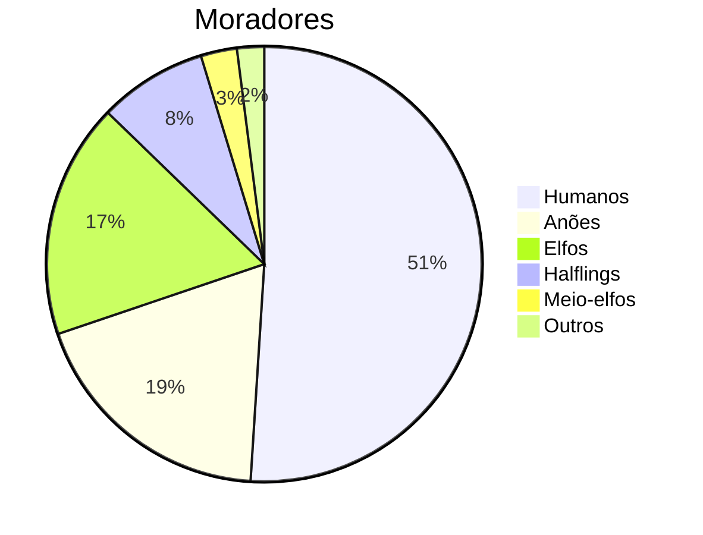

# Pasnata
## Descrição geral
**Tamanho:** Cidadela 

**População:** 7450 

**Limite individual em PO:** 8000 

O assentamento possui 29.800.000 PO dividido entre toda a população.

**Primeiras impressões:**
A Cidadela murada e seus guardas recepcionam com confiança os visitantes, como quem guarda um oásis em meio ao semiárido seco, mas ao adentrar as muralhas, qual dos três portões você escolheu para conhecer o assentamento influenciam muito as primeiras impressões. O comercio se concentra no lado leste, sendo audível de longe. Alí você encontrará qualquer tipo de atendimento necessário, poderá vender ou comprar o que Magna proporcionar. O comércio de animais é típico aos moradores, mas a lista de possibilidades é longa e passa por muitos nichos. O chão de terra batida revela pouco interesse dos governantes em investimento público.

???

## Defesa
A cidadela é murada e possui guardas preparados, porém, boa parte dos seus esforços se concentram em combater os perigos internos de um assentamento movimentado e comercial.

## Comércio
Devido à sua posição geográfica Pasnata é extremamente movimentada. Ela funciona como centro comercial entre os moradores dos assentamentos no norte de Magna, que viajam pelas Passagem Tropicis até o local para realizar compras e vendas com as criaturas do resto do continente.
Os mercados de rua vendem todos os tipos de animais domésticos e exóticos, produtos para o cuidado desses animais e alimentos diversos, em quantidades exorbitantes para o preparo de viajantes.
Em estabelecimentos especializados é possível encontrar alquimistas, médicos e clérigos trabalhando em conjunto para atender pacientes e compradores. Há serviços de atendimento à animais, ferreiros, coureiros e especialistas em magia aos montes.

**Fonte de renda distinta:**
- Piscicultura - Tucunaré.

## Organização
???

*Outros: Meio-orcs, Orcs, Goblins e Aarakocras.*

**Relações raciais:** Harmonia.

**Governo:** ???

**Líderes:** ???

## Arquitetura e estrutura urbana
- Moradias de madeira e palha com estrutura instavel.

**Diversidade cultural:** 
- É muito raro não ter animais de estimação sendo um morador de Pasnata.

**Conhecido por:** Centro comercial.

## Religião
???

**Relação com outras Religiões:** ???

## História
???

**Criada:** ???

**Atualidade:** ???

## Geografia
**Localização:** Centro de Magna.

**Clima:** Semiárido.

**Fauna e Flora:** Pasnata concentra um grande número de espécies de animais domésticos e selvagens, além de algumas raras criaturas místicas ou lendárias. A região também é caminho migratório de aves. A vegetação é geralmente rasteira e arbustiva. As árvores que resistem possuem raízes longas e cavam labirintos na busca por água.

**Topografia:** Apesar de não ter muitas alterações no relevo do assentamento, ele está na região da cadeia de montanhas Tropicis; elevado em comparação aos seus vizinhos.
